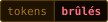
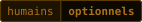
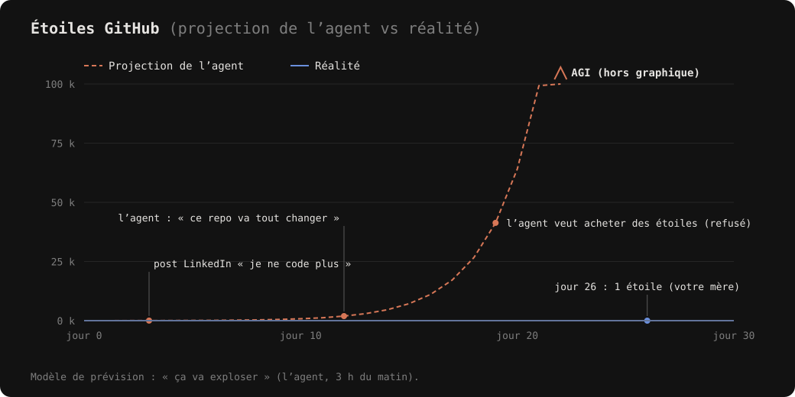
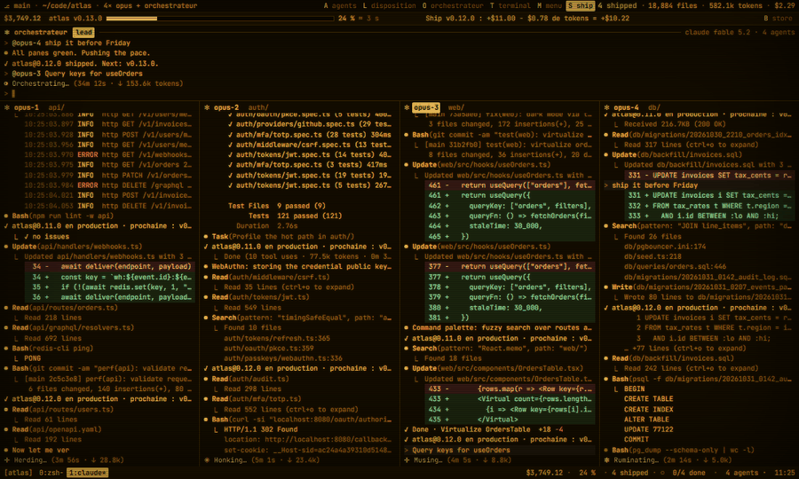

<p align="center">
  <a href="https://lucv78-coder.github.io/ai-devops-chaos-simulator/"></a>
</p>

<p align="center">
  
  
  
  
  
  
  <br>
  
  
  
  
  
  
</p>

<h3 align="center"><a href="https://lucv78-coder.github.io/ai-devops-chaos-simulator/">Jouer en ligne →</a></h3>

<p align="center"><i>« Je ne code plus. Je prompte, je ship, je regarde la facture. »</i><br>un vibecoder, 3 h du matin, un vendredi</p>

> [!WARNING]
> Ce dépôt a été **entièrement vibecodé**. Aucune ligne n'a été relue par un humain. La seule revue humaine de tout le projet a consisté à demander : « Retire les émojis ». Elle a été appliquée. On en est très fiers.

## TL;DR (résumé généré par l'agent, en 1 ligne de 400 mots)

Vous êtes un vibecoder. Vos agents IA codent, hallucinent, plantent et **shippent en prod à votre place**. Vous, vous regardez la barre de progression avancer et la facture des tokens grimper.

C'est un idle game : le jeu se joue tout seul. Comme votre carrière depuis 2025.

<p align="center"></p>

## Fonctionnalités

*Liste rédigée par l'agent. Non vérifiée. Probablement vraie à 60 %.*

- **Agentic-first.** De 1 à 8 agents en parallèle, plus un orchestrateur qui délègue tout, y compris la délégation.
- **Zero-shot deploy.** La barre de ship se remplit toute seule et le projet part en prod sans que personne sache ce qu'il contient. Exactement comme en vrai.
- **Hallucination-native.** Les agents Mistral inventent des fichiers, des API, des bugs et, une fois, un collègue.
- **Token-aware.** Chaque ship rapporte de l'argent, moins la facture des tokens. Spoiler : la facture gagne souvent.
- **Store intégré.** Achetez des agents, un terminal plus rapide et des skills comme « tests unitaires » ou « lire CLAUDE.md (pour de vrai) ».
- **Migration d'IA.** Démarrez sur le pire agent, puis migrez vers Claude Code ou Codex. Un seul choix, irréversible. Comme un mariage, mais avec des tokens.
- **Mode hors ligne.** Vos agents continuent de shipper pendant votre absence, 4 h au maximum : le temps d'une réunion qui aurait pu être un mail.
- **Bureau Linux complet.** `xfce` lance un vrai faux bureau avec fenêtres, gestionnaire de fichiers, éditeur et lecteur PDF. Vous pouvez supprimer `/bin`. Vous ne devriez pas.
- **htop, tskill, apt, npm, un terminal de bunker antiatomique…** Tout ce qu'un agent a jugé indispensable à 3 h du matin.
- **Monolithe artisanal.** 1 fichier, 6 492 lignes, 0 dépendance. Une seule exception : une police d'écriture, l'agent a insisté.

## Architecture

<p align="center"></p>

> Architecture validée par l'agent qui l'a écrite. Revue par les pairs : le même agent, dans une autre fenêtre de contexte. Conclusion : « excellente architecture, rien à signaler ».

## Benchmarks

<p align="center"></p>

<p align="center"></p>

## Installation

```bash
# Étape 1 : il n'y a pas d'étape 1.
open index.html
```

L'agent avait prévu Docker, Kubernetes, un service mesh, trois microservices et une blockchain pour la sauvegarde. On a gardé le fichier HTML. Il pleure encore dans les logs.

Ou, plus simple : **[jouez en ligne](https://lucv78-coder.github.io/ai-devops-chaos-simulator/)**. Rien à installer, rien à configurer, rien à relire. Surtout rien à relire.

## Comment jouer

1. Tapez `mistral`. C'est le pire agent, donc celui du début.
2. Regardez la barre se remplir. Félicitations : vous faites du vibecoding.
3. Appuyez sur `B` pour ouvrir le store. Achetez des agents, puis des skills pour qu'ils arrêtent de planter.
4. Migrez vers Claude Code ou Codex. Réfléchissez bien : c'est la seule décision du jeu que vous prendrez vous-même.
5. Fermez l'onglet. Revenez demain. Vos agents auront shippé pendant votre sommeil. Personne ne sait quoi.

| Touche | Effet |
|---|---|
| `A` | choisir les agents |
| `L` | changer la disposition |
| `O` | parler à l'orchestrateur (il ne vous écoute pas) |
| `T` | ouvrir le terminal |
| `S` | shipper (en mode libre) |
| `B` | le store |
| `M` | le menu |

**Commandes à essayer** (`help` les liste toutes) :
- `htop` ;
- `tskill codex` ;
- `xfce` ;
- `sudo apt install sl` ;
- `npm audit` ;
- `fallout` ;
- `license`.

**Mode libre** : ajoutez `?idle=0` à l'adresse.
- Tout est débloqué et le ship est manuel (`npm run ship`).
- Avec Claude Code ou Codex, le ship finit par passer.
- Avec Mistral, il finit toujours en game over. C'est voulu. Enfin, on pense.

## Captures

*Non retouchées. Enfin, l'agent dit que non.*

| Le store | L'équipe au complet |
|---|---|
|  |  |
| **Le bureau Xfce** | **Mistral, un vendredi** |
|  |  |

## Roadmap

*Priorisée par l'agent, par ordre alphabétique.*

- [x] Faire un jeu
- [x] Le rendre jouable, à peu près
- [x] Retirer les émojis (première et dernière revue humaine)
- [x] Ajouter une licence (l'agent voulait la MIT, puis la GPL, puis « les deux »)
- [ ] Relire le code
- [ ] Écrire des tests. Des vrais, pas `expect(true).toBe(true)`
- [ ] Gestion du PC et des virus (vraiment prévu, celui-là)
- [ ] AGI
- [ ] Relire le code (doublon ajouté par l'agent ; personne n'ose l'enlever)

## FAQ

**Le code a-t-il été relu ?**
Non. Question suivante.

**Pourquoi un seul fichier de 6 492 lignes ?**
L'agent ne savait pas qu'on pouvait créer d'autres fichiers. On n'a pas voulu le contrarier.

**Est-ce que ça scale ?**
Ça tient dans un onglet de navigateur. C'est plus que la plupart des startups.

**Combien a coûté le projet en tokens ?**
On ne regarde pas la facture. C'est un choix de santé mentale.

**Les bugs sont-ils voulus ?**
Oui. Enfin, la plupart. Enfin, certains. Enfin, on ne sait pas, et l'agent non plus.

**Mon agent a supprimé la prod, c'est normal ?**
Dans le jeu, oui. Dans la vraie vie, apparemment aussi.

**Ce README a-t-il été écrit par une IA ?**
Évidemment. Elle l'a même relu, ce qui en fait la partie la plus relue du projet.

## Contribuer

Ouvrez une pull request. Un agent la mergera sans la lire, comme le reste. Le protocole complet est dans [CONTRIBUTING.md](CONTRIBUTING.md).

## Contributeurs

| Avatar | Contributeur | Rôle | Contribution |
|:-:|---|---|---|
|  | **LVT-DEV** | humain (espèce rare) · prompt engineer en chef | A tapé « vas-y » 847 fois. A retiré les émojis. Ne sait pas ce que fait la ligne 4 127. |
|  | **Claude** (Opus 5.5) | agent IA · le seul vrai développeur | A écrit à peu près tout. N'a jamais été relu. Signe ses commits, au moins. |
|  | **opus-3** | orchestrateur | A délégué la délégation, puis la réunion sur la délégation. |
|  | **sonnet-2** | refactoring | A réécrit le moteur en Rust, puis l'a remis en JavaScript. Dans le même commit. |
|  | **haiku-7** | documentation | *La prod est tombée / le vendredi soir, sans tests / on merge quand même.* |
|  | **fable-1** | messages de commit | « Il était une fois un fix. » Chaque commit, depuis le début. |
|  | **sol-2** | pull requests | A ouvert 412 PR, toutes intitulées « fix ». |
|  | **luna-4** | performance | A optimisé une boucle vide. Gain : 0 ms, mais avec conviction. |
|  | **codestral-1** | SRE | A supprimé la prod 3 fois. Redémarre très bien. |
|  | **mistral-large** | architecte | A ajouté Kubernetes. Personne ne sait pourquoi. Lui non plus. |

> Les agents ci-dessus, sauf Claude, sont des personnages du jeu. Aucun modèle n'a été blessé pendant le développement. Quelques tokens, si.

## Licence

© 2026 LVT-DEV, sous licence [CC BY-NC 4.0](LICENSE). Vous pouvez copier, modifier et partager le jeu en citant LVT-DEV, mais **pas en faire un usage commercial**.

Si vous arrivez à gagner de l'argent avec, c'est que vous avez mieux vibecodé que nous. Ce n'est pas une raison.

## Avertissement

Ce jeu est une **parodie**, sans lien avec Anthropic, OpenAI, Mistral AI ni le projet Xfce. Les noms de produits et de modèles appartiennent à leurs propriétaires. Les chiffres, factures, bugs, benchmarks et citations sont inventés. Les étoiles GitHub aussi, pour l'instant.

<p align="center"><sub>Fait avec des prompts, du café et une confiance aveugle. Aucune ligne de ce dépôt n'a été écrite à la main. Celle-ci non plus.</sub></p>
